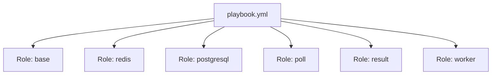

[](https://www.epitech.eu/)
[](https://www.ansible.com/)
[](#)

# 🐙 Octopus — Déploiement Automatisé Multi-Niveaux avec Ansible

**Octopus** est un projet d'infrastructure en tant que code (*Infrastructure as Code - IaC*) automatisant le provisionnement, la configuration logicielle et le déploiement d'une application distribuée multi-niveaux (Voting App) sur des serveurs Linux distants via **Ansible**.

---

## 📦 Rôles Ansible & Responsabilités

Le déploiement est structuré en rôles modulaires et idempotents selon l'architecture suivante :



- **`base`** :
  - Dépendances socle du système, mise à jour des paquets, création des utilisateurs de service et règles de sécurité.
- **`redis`** :
  - Installation et configuration du courtier de messages Redis avec fichier `redis.conf` et gestion du service systemd.
- **`postgresql`** :
  - Provisionnement du SGBD PostgreSQL, configuration des accès réseaux (`pg_hba.conf`), initialisation du schéma de données (`schema.sql`) et permissions utilisateurs.
- **`poll`** :
  - Déploiement de l'application frontale de vote en Python, configuration de l'unité de service `poll.service` et démarrage du serveur d'application.
- **`result`** :
  - Déploiement de l'interface Node.js de visualisation des résultats avec unité systemd `result.service`.
- **`worker`** :
  - Déploiement du service d'arrière-plan avec unité `worker.service` pour la consommation continue des votes depuis Redis vers PostgreSQL.

---

## 🚀 Utilisation & Déploiement

### Dérouler le Playbook complet :
```bash
ansible-playbook -i production playbook.yml
```

### Vérifier la syntaxe sans exécuter :
```bash
ansible-playbook -i production playbook.yml --syntax-check
```
